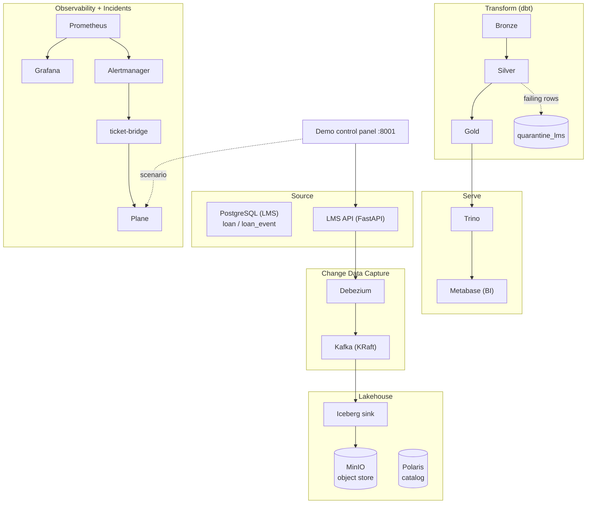
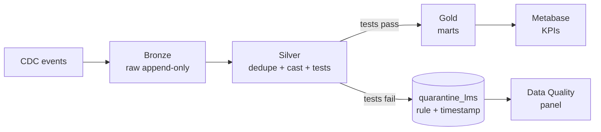
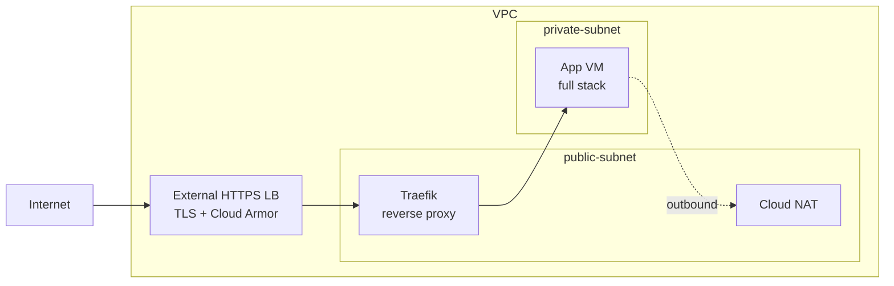

# Architecture & Diagrams

Rendered inline by GitHub (Mermaid). Each diagram is the source of truth for one view.

## 1. Full stack

## 2. Data flow — medallion + quarantine

Key property: bad data never reaches a KPI — it lands in `quarantine_lms` and is shown
in the Data Quality panel, traceable to its failing test.

## 3. Network — prod posture (public / private)

Public (via LB + Traefik + IAP/auth + TLS): `grafana.<domain>`, `demo.<domain>`
(control panel), `bi.<domain>`, `plane.<domain>`. Everything else — Postgres, Kafka,
MinIO, Polaris, Trino, dbt, Prometheus, Alertmanager — is private-only. SSH via IAP,
never `0.0.0.0/0`.
